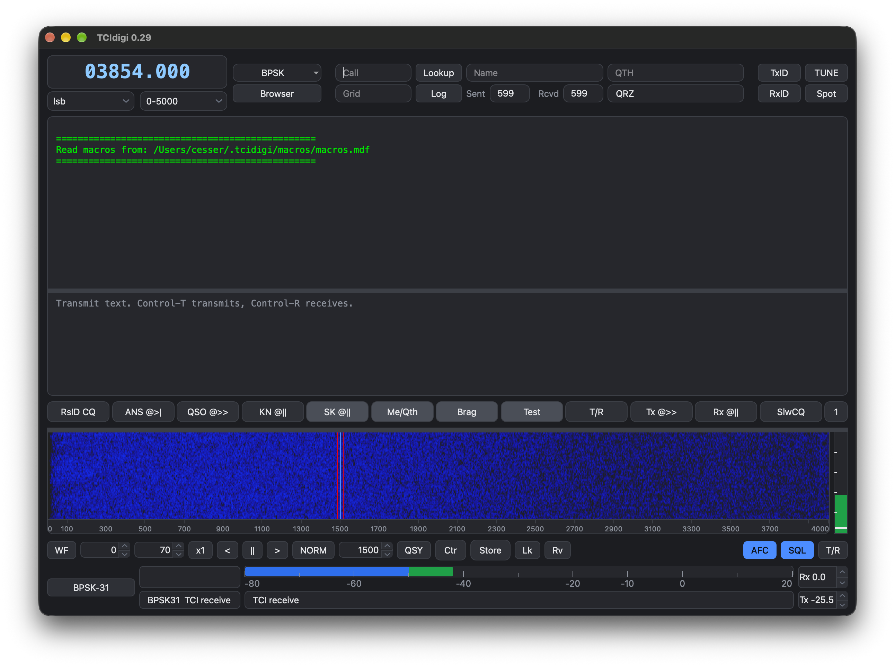

# TCIdigi

A Qt 6 interface on fldigi's modems. Radio control and modem audio use TCI,
the protocol used by 590Ctrl, ZeusSDR and ExpertSDR3. This build does not
include hamlib, rigCAT, flrig, or the sound-card backends.



Version 0.30 · Based on fldigi 4.2.13 · Licensed under the [GPL-3.0](COPYING).

The About box says "Based on fldigi." This repository is TCIdigi. It is not
the upstream fldigi project. Downloads are on the
[GitHub releases page](https://github.com/kingsqueak/TCIdigi/releases) and the
[SourceForge files page](https://sourceforge.net/projects/tcidigi/files/).

## Features

**Operating**
- fldigi's modems, with a waterfall, the receive and transmit windows, and
  the macro buttons
- The radio and the audio both go over TCI. Point it at a TCI server, such
  as 590Ctrl on `127.0.0.1:50001`
- Settings are kept in `~/.tcidigi`. TCIdigi does not read `~/.fldigi`
- Configure, Modems, IDs and General hold fldigi's settings for each mode,
  RsID, video and CW ID, the waterfall, the signal browser, transmit and
  exit. Waterfall colors picks or edits the waterfall palette
- The waterfall does fldigi's mouse actions: click to tune, drag or wheel on
  the scale to move the radio, right-click to listen, wheel actions with
  Control, Option/Command and Shift
- Help, TCIdigi Help (Command-? on a Mac) is built in and works offline

**Signal identification (SigID)**
- Names the mode of the signals in the passband without an RsID, for every
  mode TCIdigi can receive. Off by default; the SigID button turns it on
- Each signal gets a clickable mark in the receive pane and a tab on the
  waterfall. A click switches mode and moves the radio so the signal sits at
  1500 Hz
- Look-alike modes (THOR or DominoEX, Olivia or Contestia, BPSK or PSK-R)
  are told apart by decoding a few seconds of the signal

**flmsg, flamp and flarq**
- They connect to TCIdigi as they do to fldigi: XML-RPC on port 7362 and the
  ARQ socket on port 7322
- A received flmsg form is saved and opened in flmsg. The flmsg and flamp
  in /Applications are found on a Mac (Configure, General, NBEMS)

**Lookup and logging**
- Call sign lookup uses QRZ (Log, QRZ account)
- **Log** sends the contact to the QRZ logbook when a QRZ logbook key is set,
  and to eQSL.cc when Log, eQSL account has "Send to eQSL when logging"
  turned on. The status box next to the reports shows the result from each
- The eQSL account dialog takes the eQSL user ID, password, an optional QTH
  nickname (for accounts with more than one location), and a QSL message
  where `{CALL}`, `{NAME}` and `{MODE}` are filled in from the contact. It
  starts from fldigi's eQSL settings when those are set. The upload is the
  one fldigi makes, sent over https

## Installing on macOS

`TCIdigi-0.30.dmg` is on the
[GitHub releases page](https://github.com/kingsqueak/TCIdigi/releases) and the
[SourceForge files page](https://sourceforge.net/projects/tcidigi/files/).
It needs macOS 26.0 or newer on Apple silicon. Drag TCIdigi into
Applications.

The app is not notarized, so macOS can refuse the first open. Clear the
download quarantine once, then open it as usual:

```sh
xattr -dr com.apple.quarantine /Applications/TCIdigi-0.30.app
```

## Installing on Ubuntu

Packages for Ubuntu 26.04 LTS are on the
[GitHub releases page](https://github.com/kingsqueak/TCIdigi/releases) and the
[SourceForge files page](https://sourceforge.net/projects/tcidigi/files/).
They use that release's Qt 6 and FLTK, which apt installs with the package.

- `tcidigi_0.30-1_amd64.deb` for Intel and AMD PCs
- `tcidigi_0.30-1_arm64.deb` for arm64

```sh
sudo apt install ./tcidigi_0.30-1_amd64.deb
```

The program is `/usr/bin/TCIdigi`. Station tables for NAVTEX and weather
modes are installed in `/usr/share/tcidigi`.

## Building from source

One build from this tree produces two programs:

- **fldigi**, the FLTK program, built by the fldigi autotools files
  (`make -C src`). It is fldigi with the TCI and QRZ changes. `flarq` is
  built with it.
- **TCIdigi**, the Qt 6 program, built by CMake after that. It links the
  engine objects that `make -C src` compiled and uses the link line from
  `src/Makefile`, so fldigi has to be built first.

On macOS, Homebrew packages that satisfy a build here are autoconf,
automake, pkg-config, fltk, libsamplerate, libsndfile, libpng, jpeg-turbo,
gettext, and Qt 6. `glibtoolize` comes from the libtool formula. The Qt
program targets macOS 26.0 (the engine objects are compiled for 14.4).

```sh
autoreconf -fi
./configure
make -C src
cmake -S src/qtui -B build-qt \
  -DCMAKE_PREFIX_PATH="$(brew --prefix qt)" \
  -DCMAKE_OSX_DEPLOYMENT_TARGET=26.0
cmake --build build-qt --target fldigi-qt
```

### Where the programs are after the build

| Program | Path after the build | How to run it |
|---|---|---|
| fldigi (FLTK) | `src/fldigi` | `./src/fldigi` |
| flarq | `src/flarq` | `./src/flarq` |
| TCIdigi (Qt), macOS | `build-qt/TCIdigi-<version>.app` | `open build-qt/TCIdigi-<version>.app`, or `./build-qt/TCIdigi` from a shell |
| TCIdigi (Qt), Linux | `build-qt/TCIdigi-<version>` | `./build-qt/TCIdigi-<version>` |

The version comes from `src/include/tcidigi_version.h`. On macOS,
`build-qt/TCIdigi` is a small script that runs the current bundle, because
a shell cannot run the `.app` directory itself.

Installing TCIdigi with `cmake --install build-qt --prefix /Applications`
puts `/Applications/TCIdigi-<version>.app` there. Bundles from older
versions are left in place. `make -C src install` installs fldigi and flarq
under the configure prefix (`/usr/local/bin` by default).

`src/dialogs/confdialog.cxx` is already generated. Do not run `fluid` on
`confdialog.fl` unless you mean to regenerate that file.

Linux can use the same steps when Qt 6 and FLTK are installed. An Ubuntu
package is built by `scripts/make-deb.sh` on Ubuntu 26.04, and on a
macOS 26 system `scripts/make-dmg.sh` builds the DMG from Homebrew. The
Packages workflow runs both on GitHub Actions for a `v*` tag. A Windows
build (`scripts/make-windows.sh`, in an MSYS2 UCRT64 shell) is in progress
and not released yet.

Generated configure output, object files, and `build-qt/` are gitignored.

Before shipping a Mac DMG, run `scripts/mac-audit-bundle.py <App.app>`. It
checks every library in the bundle against the macOS 26.5 SDK and fails if
one imports a function macOS 26 does not have. Homebrew's glib bottle uses
`pipe2` from macOS 27, so the DMG carries a glib rebuilt from source with
the macOS 26.5 SDK and `MACOSX_DEPLOYMENT_TARGET=26.0`.
